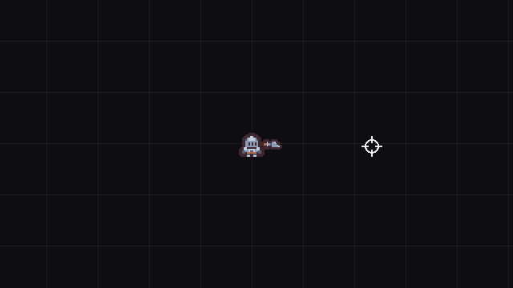

# Godot Top-Down Controller

A top-down player controller for Godot 4 with 8-direction movement, mouse aim, a
dash with i-frames and an afterimage trail, and a follow camera that leads your aim
and can shake.



The crosshair in the GIF stands in for your mouse.

## Features

- **8-direction movement** on a `CharacterBody2D` with `move_and_slide`, with
  diagonals clamped so moving diagonally is not faster than moving straight.
- **Mouse aim.** A weapon pivot points at the cursor every frame and the body
  flips to face it.
- **A dash** in your movement direction, or toward the mouse when you are
  standing still, with a cooldown and a `get_dash_ratio()` you can feed to a UI bar.
- **I-frames** during the dash, exposed as an `is_invincible` flag, with a blue
  tint so you can see them working.
- **Dash juice:** an afterimage trail, an anticipation stretch, a landing squash
  and an expanding ring.
- **Body juice without tweens:** a walk and idle bob driven by `sin()`, and a
  squash when you stop.
- **A follow camera** with smooth exponential follow and a capped lead toward
  your aim, so you see more of where you are pointing.
- **Camera shake, kick and zoom punch** you can trigger from any script:
  trauma-squared shake with roll, a directional shove, and a short zoom pop.
- **Every tuning number is exported**, so you can feel it out in the Inspector
  while the game runs.

## Demo

`Main.tscn` is an open arena with a faint grid to move against. Walk around, aim
with the mouse, and dash. Watch the knight tint blue for the length of the dash
(the i-frames) and the camera drift toward wherever you aim.

## Requirements

- Godot **4.7** or later, standard build (GDScript only, no .NET needed).
- Tested on **Godot 4.7.2 stable** on Windows. Earlier 4.x versions are untested.
- Uses the Mobile renderer, which needs Vulkan, Direct3D 12 or Metal.

## Installation

Clone the repository:

```bash
git clone https://github.com/CodingQuests/godot-top-down-controller.git
```

Or download it with **Code > Download ZIP** and unzip it.

Then open Godot, click **Import**, pick the `project.godot` file inside the folder,
and click **Import & Edit**.

## Quick Start

1. Press **F5**.
2. Move with **WASD**.
3. Aim with the **mouse**.
4. Dash with **Space**.
5. Select the `Player` node and change `move_speed` or `dash_speed` in the
   Inspector, then run again to feel the difference.

## How It Works

The player does the same five things every physics frame, in this order:

```gdscript
func _physics_process(delta: float) -> void:
	_update_aim()        # point the weapon at the mouse, flip the body
	_update_dash(delta)  # tick the cooldown, start or end a dash

	var input := Vector2.ZERO
	if _is_dashing:
		# During a dash we ignore steering: fixed speed in the locked dash dir.
		velocity = _dash_dir * dash_speed
		_emit_afterimages(delta)
	else:
		input = _get_move_input()
		velocity = input * move_speed

	move_and_slide()
	_update_body_juice(delta, input.length() > 0.1)
```

A dash locks its direction when it starts, so you cannot steer mid-dash. That is
what makes it read as a committed move rather than a speed boost.

The camera does not hold a reference to anything but its target. Anything that
wants a shake goes through the `GameManager` autoload, which the camera registers
itself with:

```gdscript
GameManager.shake_camera(0.4)              # trauma, 0 to 1
GameManager.camera.add_kick(direction, 10) # shove the view along a direction
GameManager.camera.add_zoom_punch(0.06)    # pop the zoom in by 6 percent
```

Shake strength is trauma squared, so a 0.3 trauma barely wobbles and a 0.9 trauma
kicks hard, and trauma decays on its own every frame.

## Project Structure

```
project.godot           Project file, the GameManager autoload and the input actions
Main.tscn               The demo arena: background, player and camera
scenes/Player.tscn      The player: sprite, collision shape and the weapon pivot
scripts/Player.gd       Movement, aim, dash, i-frames and the body juice
scripts/PlayerCamera.gd Follow, aim lead, shake, kick and zoom punch
scripts/GameManager.gd  Autoload that remembers the player and camera, and forwards shakes
scripts/Juice.gd        Static helpers: squash, stretch, afterimage and ring
scripts/Main.gd         Draws the reference grid. Demo only
Assets/Tiles/           Two Kenney Tiny Dungeon tiles (CC0) and their license
```

## Using It In Your Own Game

1. Copy the `scripts/` folder and `scenes/Player.tscn` into your project.
2. Add `scripts/GameManager.gd` as an autoload named `GameManager`
   (Project > Project Settings > Globals).
3. Add five input actions in Project > Project Settings > Input Map:
   `move_up`, `move_down`, `move_left`, `move_right` and `dash`.
4. Instance `Player.tscn` in your level and give it your own sprite.
5. Add a `Camera2D`, attach `PlayerCamera.gd`, and point its `target_path` at the
   player.

The player is on collision layer 2 and collides with layer 1, so put your walls
on layer 1 and it will slide along them.

To make the dash i-frames do something, check the flag in whatever applies damage:

```gdscript
if player.is_invincible:
	return
```

## Customizing It

- **Feel:** `move_speed`, `dash_speed`, `dash_duration` and `dash_cooldown` on
  the player.
- **Camera:** `follow_lerp`, `aim_lead`, `aim_lead_max`, `max_offset`,
  `max_roll_degrees` and `trauma_decay` on the camera. Set `aim_lead` to 0 to turn
  the aim lead off.
- **Acceleration:** movement is instant on purpose, which feels snappy. For a
  heavier character, ease toward the target velocity instead:

  ```gdscript
  @export var acceleration: float = 1400.0

  # in _physics_process, replacing velocity = input * move_speed
  velocity = velocity.move_toward(input * move_speed, acceleration * delta)
  ```

- **Gamepad movement:** add joypad axis events to the four move actions and a
  joypad button to `dash`. Movement reads action strength, so analog sticks work
  with no code changes. Aim still follows the mouse (see Known Limitations).
- **Dash trail colour:** the tint passed to `Juice.afterimage()` in
  `_emit_afterimages()`.

## Known Limitations

- Keyboard and mouse only out of the box. Aim reads the mouse position, so
  right-stick aiming needs a few extra lines.
- The demo arena has no walls, so collision is not shown. The player is a normal
  `CharacterBody2D` and slides along anything on collision layer 1.
- `is_invincible` is a flag. Nothing in this project damages the player, so the
  i-frames only matter once your damage code reads it.
- No sound. Play your dash sound in `_start_dash()`.
- Tested on Godot 4.7.2 on Windows only.

## License

MIT for the code. See [LICENSE](LICENSE).

## Third-Party Assets

The knight and sword sprites are from
[Tiny Dungeon](https://kenney.nl/assets/tiny-dungeon) by Kenney, released under
CC0 1.0. Details in [THIRD_PARTY_ASSETS.md](THIRD_PARTY_ASSETS.md), and the pack's
original license is in `Assets/Tiles/License.txt`.

## Learn How It Works

Want to understand how this works instead of just copying it?

CodingQuests teaches you how to build systems like this step by step in Godot,
with interactive lessons and real projects.

- **[2D Roguelike: Top-Down Controller](https://codingquests.io/quests/2d-roguelike-controller?utm_source=github&utm_medium=resource&utm_campaign=godot_top_down_controller)**
  builds this controller one piece at a time, written and graded in your browser.
  Free, 8 lessons.
- **[2D Roguelike: Combat Core](https://codingquests.io/quests/2d-roguelike-combat-core?utm_source=github&utm_medium=resource&utm_campaign=godot_top_down_controller)**
  carries on from here with health, hitboxes and hurtboxes, and a weapon.

Made by [CodingQuests](https://codingquests.io/?utm_source=github&utm_medium=resource&utm_campaign=godot_top_down_controller).
